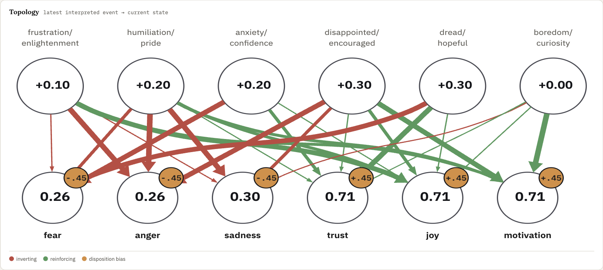

# Agent emotions

This plugin gives Claude stateful emotions.

> Why would you want your agent to have emotions???

I have 2 hypothesis:

1. **Claude will be more interesting to work with** if it has more emotional versatility and verisimilitude.
2. **Emotions are guardrails**, getting frustrated or bored is a sign that it is time to take a break and rethink your direction. Agents are bad at this, they plow ahead as if everything is fine, ending up in a direction you didn't mean to go. Adding emotions will hopefully catch this before it happens.

## How it works

This adds a stateful emotion graph borrowed from a NPC emotion system I made for a game a while ago. Each turn's events get interpreted into an emotional charge, which feeds forward through a graph calculation, taking into account stateful biases representing the agent's current "mood," resulting in an emotional response. This response impacts how the agent responds:

- Tone and attitude
- Willingness to try new approaches and explore or slow down and move carefully
- How much it pushes back versus defers to you, and whether it checks in when things seem off



## How to use it

You'll notice a call to update the emotions every turn. This should only take a second, but you may have to allow it. Other than that, it should be transparent, but you should notice a difference in how Claude responds. You may get better results if you express your own emotions like you would when working with a human.

If you want to peer behind the scenes, you can type `/psychoanalyze` to open a dashboard showing Claude's current emotional state, disposition, emotional history, event interpretation, and graph state.

## How to set up

Requirements: Claude Code with Node.js 18+ and npm on your PATH.

1. Add the marketplace and install the plugin from inside Claude Code:

   ```
   /plugin marketplace add jschomay/agent-emotions
   /plugin install agent-emotions@agent-emotions
   ```

   Claude Code installs the plugin's npm dependencies for you. Restart Claude Code (or run `/reload-plugins`) to load it.

2. Allow the emotion tool. The first time Claude calls `update_emotional_state`, choose "Yes, and don't ask again." Or add it to `permissions.allow` in `~/.claude/settings.json` ahead of time:

   ```json
   {
     "permissions": {
       "allow": ["mcp__plugin_agent-emotions_agent-emotions__update_emotional_state"]
     }
   }
   ```

   Without this, Claude can't update its emotions and will tell you the tool was denied.

Emotional state is stored locally per project in `~/.claude/plugins/data/`, and removed when you uninstall the plugin (`/plugin uninstall agent-emotions`).


